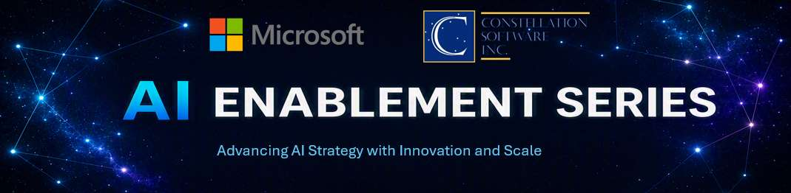

# CSI AI Enablement Series

> Microsoft's AI enablement series for teams across the Constellation
> Software Inc. (CSI) portfolio.

Explore how Microsoft partnerships, platforms, and CSI support resources can
help turn AI investments into measurable business value. Sessions cover AI
strategy, data readiness, production AI, application modernization, and
AI-native software engineering.

This is a separate learning stream from [CSI Build Days](../build-days/).

[Back to the resource hub](../README.md#csi-ai-enablement)

---

## Series schedule

All sessions start at **11:00 a.m. Eastern Time (ET)**. The full schedule
includes past dates; open each Microsoft Teams event page for current
availability and registration.

| Scheduled date | Session topics | Microsoft Teams |
|:---|:---|:---|
| October 6, 2026 | [Anthropic and Fireworks partnership with Microsoft](#anthropic-and-fireworks-partnership-with-microsoft) | [View event](https://msit.events.teams.microsoft.com/event/msit.e5bd3bff-42bc-4537-838f-326651ca7218@72f988bf-86f1-41af-91ab-2d7cd011db47?source=copyLinkLegacyShareEventDialog) |
| October 13, 2026 | [Data platform and AI readiness with Fabric and Fabric IQ](#data-platform-and-ai-readiness-with-fabric-and-fabric-iq) | [View event](https://msit.events.teams.microsoft.com/event/msit.9053e6de-8787-4bd1-8529-3acc1bc68fba@72f988bf-86f1-41af-91ab-2d7cd011db47?source=copyLinkLegacyShareEventDialog) |
| October 20, 2026 | [AI strategy and use case framework](#ai-strategy-and-use-case-framework) | [View event](https://msit.events.teams.microsoft.com/event/msit.dbc6ee89-36a6-47c3-8f19-cb405d3d4be1@72f988bf-86f1-41af-91ab-2d7cd011db47?source=copyLinkLegacyShareEventDialog) |
| October 27, 2026 | [Building and scaling AI solutions with Microsoft Foundry](#building-and-scaling-ai-solutions-with-microsoft-foundry) | [View event](https://msit.events.teams.microsoft.com/event/msit.82ad6ef2-b49c-4360-8649-0a49f3379a79@72f988bf-86f1-41af-91ab-2d7cd011db47?source=copyLinkLegacyShareEventDialog) |
| November 3, 2026 | [Modernize as an AI enabler](#modernize-as-an-ai-enabler) | [View event](https://msit.events.teams.microsoft.com/event/msit.e79807c0-8d01-4988-8dc2-0d62929d654f@72f988bf-86f1-41af-91ab-2d7cd011db47?source=copyLinkLegacyShareEventDialog) |
| November 10, 2026 | [AI-native software engineering with GitHub Copilot](#ai-native-software-engineering-with-github-copilot) | [View event](https://msit.events.teams.microsoft.com/event/msit.7e6232a1-3627-4122-84ac-9af91d8d873e@72f988bf-86f1-41af-91ab-2d7cd011db47?source=copyLinkLegacyShareEventDialog) |

---

## Session details

### Anthropic and Fireworks partnership with Microsoft

Learn how Microsoft's partnership with Anthropic and Fireworks AI supports
the move from AI development into production with Microsoft Foundry,
including securing and optimizing model deployments.

### Data platform and AI readiness with Fabric and Fabric IQ

- Fabric IQ and data agents, including data ontology and semantics.
- Data readiness and governance.
- Fabric, OneLake, and the data foundations for AI.

### AI strategy and use case framework

- A framework for evaluating AI opportunities.
- Real-world examples from CSI businesses.
- A methodology for moving from idea to production.

### Building and scaling AI solutions with Microsoft Foundry

- Moving beyond copilots and experimentation.
- Using Microsoft Foundry for enterprise AI deployments.
- LLM hosting, security, and governance.

### Modernize as an AI enabler

- Legacy application modernization.
- Data migration and cloud platform strategy.
- AI-ready application architecture.
- Partner-supported Microsoft investment and transformation programs.

### AI-native software engineering with GitHub Copilot

Accelerate development and enhance code quality with AI-native software
engineering practices:

- Build and ship faster with GitHub Copilot and AI agents.
- Boost developer productivity across the software development lifecycle.
- Deliver secure, high-quality software with AI-powered DevOps.

---

## Registration and access

Registration is handled on the Microsoft Teams event pages linked above.
Use the page for the session you want to attend to check availability,
confirm the schedule in your local time zone, and register where available.
Follow any access requirements shown by the organizer.

The schedule and topics are based on the series announcement. Past dates do
not imply that recordings are available; the announcement did not include
recording links.

---

## Get in touch

For questions about this series or participation across your business unit,
contact your Microsoft account team.

For corrections or suggestions for this resource hub, email the GitHub @ CSI
team at [DevsAtCSI@microsoft.com](mailto:DevsAtCSI@microsoft.com).
